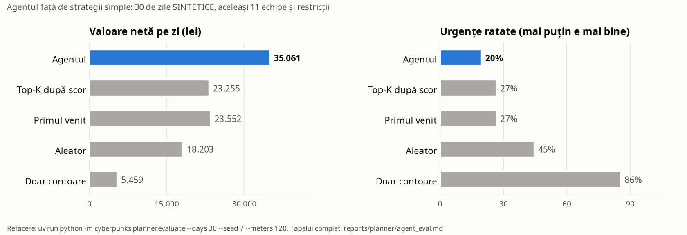

# Evaluarea agentului (planificatorul)

Ce dovedește: că stratul de decizie al agentului (reguli cu prag justificat de cost, citire la distanță, om în buclă, trasee OR-Tools) aduce mai multă valoare decât felul simplu de a trimite echipele, pe aceleași echipe, ture și restricții. E dovada pentru criteriul „Agentul” din grila PPC.

Fișiere:

| Fișier | Ce conține | Cum se refac cifrele |
|---|---|---|
| `agent_eval.json` | toate cifrele evaluării, pe zile și pe strategii | `uv run python -m cyberpunks.planner.evaluate` (~2 min) |
| `agent_eval.md` | tabelele, generate din `agent_eval.json` (nicio cifră scrisă de mână) | aceeași comandă |
| `solver_benchmark.json` | OR-Tools față de inserarea greedy, pe 100, 200 și 300 de lucrări | `uv run python -m cyberpunks.planner.benchmark` (~6 min) |

Rezultatele (tabelele) sunt în `agent_eval.md`; graficul, generat de aceeași comandă:

## Lumea simulată (SINTETICĂ)

Datele reale nu au adevărul pentru deciziile de mâine (nu știm ce ar fi găsit echipa la fiecare contor, sau dacă furtuna chiar ar fi rupt linii). De aceea evaluarea agentului rulează pe o lume sintetică în care adevărul e cunoscut: `cyberpunks.planner.simulate`. Modelele ML se evaluează separat, pe date reale, în `reports/A`, `reports/B`, `reports/C`, `reports/bilant`.

- **Scoruri calibrate prin construcție**: pentru fiecare lucrare, adevărul se trage Bernoulli(scor). Testul de robustețe strică asta: adevărul ~ Bernoulli(scor^1,6), adică un model prea încrezător.
- **A, contoare**: 120 de candidați pe zi în București-Ilfov; 35% manipulare, 65% defect; scor ~ Beta(1,3; 2,2); energia pierdută pe zi lognormală (mediana 9 kWh la manipulare, 6 la defect), de 8 ori mai mare la 6% clienți non-casnici; valoarea = kWh pe zi × 90 de zile × 0,70 lei/kWh (din `config/economics.yaml`); 3% abțineri; 85% contoare citibile de la distanță.
- **B, furtună**: 2 zile din 5 sunt cu furtună (3-7 zone cu risc; în celelalte, 0-2 zone cu risc mic), pe zone reale din Muntenia, Dobrogea și Banat; clienți afectați (P50) lognormal cu mediana 700; valoarea = clienți × 2,5 h × 12 lei pe client-oră; furtuna începe între 11:00 și 16:00.
- **C, tensiune**: în 70% din zile e soare (4-12 posturi; altfel 0-3); energia fotovoltaică pierdută pe sezon 1.500-9.000 kWh × 0,40 lei/kWh; la jumătate din posturi întreruperea pentru priză e deja anunțată.

Toți parametrii de simulare sunt IPOTEZE de simulare, scrise în cod (`simulate.py`). Costurile și prețurile sunt aceleași ca în agent (`config/economics.yaml`), ca simularea și planificatorul să nu folosească cifre diferite.

## Strategiile comparate

Toate folosesc aceleași 11 echipe simulate (`config/crews.yaml`), aceleași ture (08:30-15:30, după instructaj și pauză), aceleași abilități, aceleași ferestre de timp (echipa de furtună ajunge cu o oră înainte) și aceeași regulă ANRE de preaviz (fără întrerupere neanunțată pentru priză).

| Strategie | Cum alege |
|---|---|
| Agentul | regulile din `decide.py` (prag de rentabilitate, marja la încredere medie, pragul etic, „nu sunt sigur” la om, citire la distanță, plafonul de furtună pe regiune) + traseele OR-Tools |
| Top-K după scor | trimite echipele la lucrările cu scorul cel mai mare, până se umplu turele |
| Primul venit | în ordinea în care au sosit lucrările |
| Aleator | în ordine aleatoare |
| Doar contoare | doar sursa A, după scor: cum ar arăta un sistem cu un singur model |

Strategiile simple folosesc inserarea greedy în ordinea lor, deci traseele lor sunt rezonabile, nu absurde.

## Cum se socotește

- **Valoare capturată**: doar din lucrările făcute de echipe pe probleme reale: contor verificat (valoarea energiei pierdute oprite), echipă trimisă din timp unde furtuna chiar a rupt linii (clienți-ore evitate), priză schimbată unde tensiunea chiar trecea de limită.
- **Costuri**: costul acțiunii (vizită, tură, priză, analizor) + drumul (km × 1,2 lei + timpul oamenilor din echipă).
- **Prudent pentru agent**: o citire la distanță, un mesaj sau un caz trimis la om nu primesc nicio valoare în ziua respectivă, doar costul. În realitate, o citire care confirmă problema duce la o vizită a doua zi.
- **Valoare netă** = valoare capturată − costuri, pe zi, medie pe toate zilele.
- **Vizite fără problemă reală**: vizite unde adevărul era „nimic”; pe surse în `agent_eval.md`.
- **Urgențe ratate**: furtuni reale fără echipă trimisă din timp, plus cazuri de siguranță reale nevizitate.

## Ce mai arată raportul

- **Ablații**: agentul fără pragul etic și agentul cu trasee greedy în loc de OR-Tools, pe aceleași zile. Pragul etic costă valoare, dar scade vizitele la clienți fără nicio problemă. E un compromis ales conștient: nu batem la ușa unui client la care e mai probabil să nu fie nimic.
- **Sensibilitate**: costul pe client-oră (5,5-15 lei), tura de furtună (1.500-4.100 lei) și vizita (180-340 lei) variate pe intervalele din `docs/research/planificator.md`; agentul rămâne în față.
- **Solverul**: OR-Tools față de greedy pe 100-300 de lucrări candidate (`solver_benchmark.json`): câte procente de valoare netă aduce optimizarea și în câte secunde.

## A doua evaluare: ziua demo, pe lucrările reale ale modelului A

Lumea sintetică arată cât valorează stratul de decizie dacă modelele sunt calibrate. A doua evaluare folosește ieșirea reală a modelului A pentru 8 iulie 2025 și adevărul injectat de firul A în contoarele din Londra (`outputs/work_items/demo-vara/A_ground_truth.csv`). Valoarea capturată e valoarea reală a problemei, nu estimarea modelului. Pentru B și C nu avem adevărul zilei, deci secțiunea e doar pentru contoare.

Reproducere: întâi ieșirea lui A (`uv run python -m cyberpunks.a_contoare.predict --scenario demo-vara --date 2025-07-08`, care scrie `A.jsonl` și `A_ground_truth.csv`), apoi `make agent-eval`. Fără ieșirea lui A, raportul nu are secțiunea zilei demo.

Ce arată: agentul trimite întâi cazurile cu risc pentru oameni (regula `R-SAFETY`, obligatorie de la scorul 0,7), chiar dacă valorează puțin în lei. De aceea vizitează mult mai multe cazuri reale de siguranță decât ordinea pe valoare a modelului A, dar capturează mai puțini lei. Ablația „fără siguranța obligatorie” arată cât costă regula. E o alegere de politică (`global.safety_mandatory` în `config/planner.yaml`), lăsată vizibilă.

## Limite (spuse cinstit)

- Lumea e sintetică; cifrele arată cât valorează stratul de decizie dacă modelele sunt calibrate, nu cât câștigă PPC mâine.
- Fiecare zi se socotește separat: lucrările amânate nu trec în ziua următoare.
- Accelerarea restabilirii prin echipe trimise din timp (2,5 h) și costul pe client-oră (12 lei) sunt IPOTEZE; de aceea sensibilitatea.
- Planul real (pe ieșirile modelelor A, B, C pentru 8 iulie 2025) e în `outputs/demo/`; acolo nu avem adevărul, deci nu dăm valoare capturată, doar decizii, trasee și motive.
