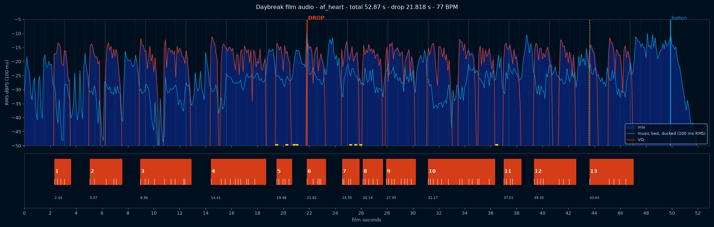

# Daybreak film: the audio track (the clock)

The VO and the music set the timing for every cut in the film (`../FILM_V3.md`). Everything here is built
locally by scripts in `tools/`. Anything that contains the commercial song stays in `local/`, which
has its own `.gitignore` (`*`, `!.gitignore`).



## What is here

| File | What it is | Contains the song? |
|---|---|---|
| `vo/<voice>/line_XX.wav` | Every VO line on its own, Kokoro at 24 kHz / 24-bit, three voices | no |
| `vo/<voice>/lines.json` | Text, speed and the exact speech span of every sentence in each line | no |
| `vo/vo_af_heart.wav` | **Main VO track** in film time (processed, 48 kHz stereo, at mix gain) | no |
| `vo/vo_am_michael.wav`, `vo/vo_bm_george.wav` | Alternate full VO tracks, each with its own timing | no |
| `vo/asr.json` | The whisper.cpp check: what was heard for every line and voice | no |
| `sfx_stem.wav` | The procedural SFX alone, in film time (af_heart timing) | no |
| `timing.json` | **The clock** for af_heart: lines, words, drop, beats, SFX cues, total | no |
| `timing_am_michael.json`, `timing_bm_george.json` | The same for the alternate voices | no |
| `timeline.png` | Picture of the af_heart timeline (levels, ducking, lines, words, beats) | no |
| `local/daybreak_mix.wav` / `.m4a` | **Final mix**, af_heart | yes |
| `local/daybreak_mix_am_michael.*`, `local/daybreak_mix_bm_george.*` | Full mixes for the alternate voices, so Teo can pick by ear | yes |
| `local/music_cut.wav` | The POWER cut on its own (af_heart length, unducked) | yes |
| `local/music_bed_ducked.wav` | The music as it sits in the mix (ducked) | yes |
| `local/power_instrumental_full.wav` | The downloaded instrumental | yes |

## The af_heart timeline (film seconds; start/end = first/last word)

| # | VO | af_heart | am_michael start | bm_george start |
|---|---|---|---|---|
| 1 | A storm hits Banat. | 2.34–3.59 | 2.34 | 1.56 |
| 2 | Poles fall. Houses go dark. | 5.07–7.55 | 4.67 | 3.90 |
| 3 | Meters get tampered with. Rooftop solar overloads the grid. | 8.96–12.87 | 8.57 | 7.79 |
| 4 | Tomorrow, eleven crews must fix five hundred and fifty-six problems. | 14.41–18.66 | 14.03 | 13.64 |
| 5 | Where should each crew go? | 19.48–20.65 | 19.48 | 19.09 |
| 6 | Daybreak plans it for you. | **21.82**–23.27 | 21.82 | 21.82 |
| 7 | It finds the problems, | 24.55–25.86 | 24.93 | 25.32 |
| 8 | puts the urgent ones first, | 26.14–27.67 | 26.69 | 27.23 |
| 9 | and plans the shortest route for every crew. | 27.95–30.19 | 28.70 | 29.50 |
| 10 | Is this meter really tampered with? When Daybreak isn't sure, the dispatcher decides. | 31.17–36.31 | 32.34 | 33.51 |
| 11 | Crews leave at daybreak. | 37.01–38.36 | 38.96 | 41.30 |
| 12 | Thirty percent less driving. Fewer wasted trips. | 39.35–42.58 | 41.69 | 44.02 |
| 13 | Daybreak. Tomorrow's crews, planned tonight. | 43.64–47.01 | 46.75 | 49.87 |

- **Drum drop: 21.818 s** = the first word of line 6, in all three versions.
- Total: af_heart **52.87 s**, am_michael 55.99 s, bm_george 59.10 s.
- Music: 2.34 s before line 1; held silence of 1.17 s after line 5 (the intro keeps playing, with clock
  ticks and a whoosh into the drop); 2.86 s of full-level music after line 13, then the final hit at
  **49.870 s** rings out to the end (3 s).
- Gaps: 0.28 s inside the 7→8→9 sentence, 1.28 s after the drop (the planet unfolds into the map),
  0.82 s from line 4 to 5, and 0.7–1.54 s between the other scenes. The 7-bar intro is 1.5 s longer than
  the opening needs at the brief's gaps (6 bars would be too short), so the opening scenes get 1.4–1.5 s
  each. Every scene line starts on the music grid; lines 6, 10 and 13 start on downbeats, the others
  on a beat or half-beat.

## timing.json

- `lines[]`: `index`, `text`, `start`, `end` (first/last word), `file_start` (where the WAV is placed),
  `words[]` with `word`, `start`, `end`. All times are film seconds.
- `music`: `drop`, `button` (final hit), `bpm` 77.000, `beat_s` 0.779212, `bar_s` 3.116846, the edit points
  and source segments, and `beats[]`: every beat in film time with `bar` (0 = the drop bar, negative =
  intro), `beat` 1–4, `downbeat`, and `detected` (the onset librosa found in the cut, `null` when the beat
  is too soft to detect).
- `sfx[]`: the cue times of the ticks, whoosh, pin tocks and cursor click.

Word timing: the edges of each sentence are exact, because each sentence was rendered separately and
its speech span measured. Inside a sentence, each word boundary is the average of the whisper.cpp
boundary and a letter-weighted estimate, then snapped to a real pause or a clear energy dip within
60 ms. Expect ±60 ms, enough for word reveals on screen. (whisper.cpp's DTW token times need
`-nfa`; I tested them and they carried a steady ~0.2 s offset, so they're not used.)

## Voice-over

- **Kokoro-82M v1.0** through `kokoro-onnx` 0.6.1 (ONNX, CPU), model files `kokoro-v1.0.onnx` and
  `voices-v1.0.bin` from the kokoro-onnx GitHub release `model-files-v1.0`.
- Voices: `af_heart` (main, American English), `am_michael` (American English), `bm_george`
  (British English). Speed 0.93 for all lines (a little slower than the default).
- Each sentence is rendered on its own and joined with a fixed pause (0.32–0.42 s inside a line,
  0.70 s after "Daybreak." in line 13), so the pacing is deliberate and the same for every voice.
- Numbers are spoken as written in the script: "eleven", "five hundred and fifty-six", "Thirty percent".
- Pronunciation fixes (in `tools/tts.py`):
  - **Banat** is said the Romanian way, ba-NAT (`banˈat`). Kokoro's default "BAN-at" was heard as
    "Bannet"/"bayonet"; I tested seven variants and `banˈat` passed whisper for all three voices.
  - af_heart, line 13: the -d of "planned" disappeared before "tonight" (heard as "plan tonight", also
    inside the full mix), so the line uses `plˈæːnd tʊnˈaɪt`. It passed on its own, in an excerpt and in the full mix.
  - am_michael, line 11: "at" was reduced to "a", so the line uses `lˈiːv ˌæt`.
- Check: every line of every voice was transcribed with whisper.cpp (large-v3-turbo) and compared word
  for word with the script, after normalizing numbers. **39/39 pass.** Two pairs sound the same in
  Kokoro's phonemes and whisper can't tell them apart, so they count as a pass: crews/cruise and
  poles/polls. The af_heart full mix also transcribes word for word. In the alternates' full mixes,
  whisper's long-form decoding skipped or swapped words in line 9; excerpts of those exact moments
  transcribe correctly.

## Music cut (local only)

Source: Kanye West, "POWER" (instrumental), YouTube `8EtoMEM00Us`, downloaded with yt-dlp (audio only).
It matches the earlier 30 s cut exactly (cross-correlation offset 15.534 s, r = 0.98).

Measured grid of the original: **77.00 BPM** (beat 0.779212 s, bar 3.116846 s, residual 5 ms), the song
starts on a downbeat at 0.104 s, the intro is 8 bars, and the drums drop at **25.039 s**, the downbeat of
verse bar 1. The old cue (9.474 s into the cut = 25.008 s) was 30 ms early. Verse 1 is 16 bars of a
near-identical loop (bar 4 is a break, bars 8 and 16 are phrase-end variations), and the hook comes in
at 74.908 s.

The af_heart cut (every edit on a downbeat, 8 ms linear crossfade ending 8 ms before the transient):

| Film | Original | What |
|---|---|---|
| 0.000–43.636 | 3.221–46.857 | intro bars 2–8 (0.25 s fade-in), drop at 21.818, verse bars 1–7 |
| 43.636–49.870 | 68.675–74.908 | verse bars 15–16, the turnaround into the hook (line 13 lands on this downbeat) |
| 49.870–52.870 | 74.908–77.908 | the hook downbeat as the final hit: hold 0.1 s, −17.6 dB/s decay, low-pass closing from 16 kHz to 900 Hz, a little reverb, faded to silence |

So the music ends on a phrase start, not mid-loop. The alternates use the same layout with more verse
bars (`timing_<voice>.json` → `music.segments`). Beats were detected in the cut with librosa and refined
to onset peaks: 61 of 65 beats found, on average 5 ms from the 77 BPM grid (sd 12 ms). The four not found
are the last three beats before the final hit and the hit itself, where the beat tracker stops.

## Mix

- VO: every line normalized to the same loudness, then high-pass at 75 Hz, −1.5 dB at 280 Hz, +1.5 dB at
  3.2 kHz, +1 dB shelf at 8.5 kHz, 2.5:1 compression (4 ms / 120 ms), a light de-esser and 4.5 dB of peak
  limiting on plosives (4× oversampled, 3 ms look-ahead).
- Music: in the gaps it plays at about the voice's loudness (measured −13.2 LUFS after the drop vs
  −13.5 for the lines); intro +2 dB (it is ~10 dB softer than the verse).
  Ducking −10 dB before the drop and −12 dB after it, with a raised-cosine ramp down over 200 ms
  (it starts before the first word) and up over 250 ms. Lines less than 0.5 s apart stay ducked.
  On line 6 the drum drop hits at full level and the duck (−12 dB) only starts 50 ms after it. Full
  level in every gap, at the drop and in the outro. Measured (K-weighted): voice 10–15 LU above the
  music under the lines; line 10 is 9.4 LU and line 6 is 7.9 LU, because of the drop.
  The music bus shaves 2.5 dB off the instrumental's sharp transients.
- SFX (procedural, numpy, mixed low): clock ticks on the beats under line 5 and the held silence
  (19.48, 20.26, 21.04), a short rising whoosh into the drop (20.82–21.82), three soft pin "tocks" as
  "problems" light up (25.20, 25.59, 25.97), and a cursor click on "Approve" after "decides" (36.46).
- Master: gain to −14 LUFS, then a true-peak limiter (4× oversampled) at −1.3 dBTP. It only acts on a
  few milliseconds at the drop (max 1.2 dB).

### Measured (ffmpeg `ebur128=peak=true`)

| File | Integrated | True peak | LRA |
|---|---|---|---|
| `local/daybreak_mix.wav` | **−14.0 LUFS** | **−1.3 dBTP** | 2.6 LU |
| `local/daybreak_mix.m4a` (AAC 256 kb/s) | −14.0 LUFS | −1.3 dBTP | 2.6 LU |
| `local/daybreak_mix_am_michael.m4a` | −14.0 LUFS | −2.1 dBTP | 2.5 LU |
| `local/daybreak_mix_bm_george.m4a` | −14.0 LUFS | −1.3 dBTP | 1.9 LU |

All mixes are 48 kHz stereo; the WAVs are 24-bit.

## Rebuild

```bash
# 1. environment + model files (once)
uv venv /tmp/kokoro -p 3.12
VIRTUAL_ENV=/tmp/kokoro uv pip install kokoro-onnx soundfile librosa numpy scipy pyloudnorm matplotlib
mkdir -p /tmp/kokoro-models && cd /tmp/kokoro-models
curl -LO https://github.com/thewh1teagle/kokoro-onnx/releases/download/model-files-v1.0/kokoro-v1.0.onnx
curl -LO https://github.com/thewh1teagle/kokoro-onnx/releases/download/model-files-v1.0/voices-v1.0.bin
cd -   # back to presentation/frames-3d/audio

# 2. the instrumental (local only)
yt-dlp -f bestaudio -x --audio-format wav -o "local/power_instrumental_full.%(ext)s" "https://www.youtube.com/watch?v=8EtoMEM00Us"

# 3. VO lines (all voices), then the whisper check
/tmp/kokoro/bin/python -I tools/tts.py /tmp/kokoro-models/kokoro-v1.0.onnx /tmp/kokoro-models/voices-v1.0.bin vo
/tmp/kokoro/bin/python -I tools/check.py vo vo/asr.json          # prints OK/BAD per line
#    (one line: tools/tts.py ... vo af_heart 13 ; CHECK_LINES=13 tools/check.py vo vo/asr.json af_heart)

# 4. schedule + music cut + mix + timing (first voice = main)
/tmp/kokoro/bin/python -I tools/build.py . af_heart am_michael bm_george
/tmp/kokoro/bin/python -I tools/plot.py .
```

The whole build after step 3 takes about 15 seconds. `tools/build.py` holds every mix setting at the top
(gap rules, levels, duck depths) and `tools/music.py` the grid and the cut layout.

## Licences

- Kokoro-82M model weights and voices: **Apache-2.0** (hexgrad/Kokoro-82M). Output audio can be used freely.
- kokoro-onnx: MIT (thewh1teagle/kokoro-onnx). onnxruntime: MIT.
- whisper.cpp: MIT; Whisper large-v3-turbo weights: MIT (OpenAI).
- librosa: ISC; numpy, scipy, soundfile: BSD; pyloudnorm: MIT; ffmpeg: LGPL/GPL (used as a tool).
- SFX: generated here in code, no samples.
- **"POWER" (Kanye West, instrumental) is commercial and copyrighted.** Teo approved it only for the
  local presentation in the room: never in git and never in a versioned export. Files with it are only
  in `local/`.
