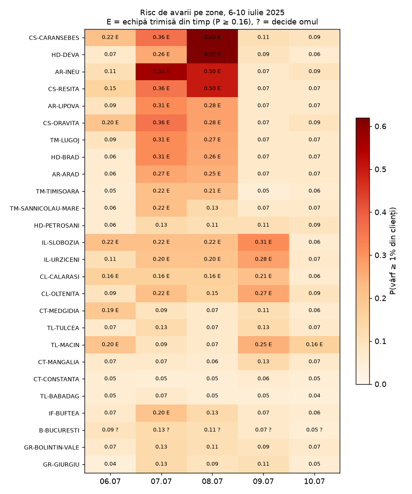

# Backtest în România: furtuna din Banat, 6-10 iulie 2025

Generat de `uv run python -m cyberpunks.b_furtuna.backtest`. Pentru fiecare zi, agentul rulează în seara de dinainte, la 18:00, cu vremea zilei din arhiva Open-Meteo (aceeași sursă ca la antrenare). Incertitudinea vine din trei modele de prognoză (ICON, ECMWF IFS, GFS). Model: `b-lgbm@c5c8344`, prag 0.16.

**Limita:** nu avem istoricul de avarii Rețele Electrice. Comparăm cu presa: ce zone, ce zi, ce ordin de mărime. Modelul e validat pe date externe (SUA, EAGLE-I) și trebuie calibrat pe istoricul RER.

## Ce a scris presa

| Ziua | Unde | Ce s-a întâmplat | Sursa |
|---|---|---|---|
| 2025-07-07 | Caraș-Severin | Furtună la Reșița (rețeaua de tramvai ruptă) și la Caransebeș (acoperiș smuls, rafale de peste 80 km/h). | https://tvrinfo.ro/?p=548910 |
| 2025-07-08 | Timiș, Arad, Caraș-Severin, Hunedoara | ANM: cod roșu de vijelii 15:00-21:00, rafale de 90-110 km/h. Transelectrica: rafale de 90-120 km/h, stâlpi avariați pe linia de 220 kV Reșița-Timișoara. | https://a1.ro/news/vremea/cod-rosu-de-vijelii-puternice-in-10-judete-din-tara-ce-zone-sunt-afectate-de-ploaia-torentiala-grindina-si-vant-dupa-canicula-id1139539.html ; https://hotnews.ro/?p=2020474 |
| 2025-07-07..09 | Timiș (și Banat) | Prefectul Timișului: circa 40.000 de consumatori afectați în 82 de localități, cumulat; 80 de echipe Rețele Electrice și contractori pe teren în Timiș, Arad, Hunedoara, Caraș-Severin. | https://www.pressalert.ro/2025/07/stalpi-de-inalta-tensiune-doborati-de-furtunile-din-ultimele-zile-in-timis/ |
| 2025-07-08 | București, Ilfov, Giurgiu, Ialomița, Călărași | ANM: cod roșu de caniculă (38-41 °C); nicio furtună raportată. | https://a1.ro/news/vremea/cod-rosu-de-vijelii-puternice-in-10-judete-din-tara-ce-zone-sunt-afectate-de-ploaia-torentiala-grindina-si-vant-dupa-canicula-id1139539.html |

## Ce ar fi recomandat agentul

| Ziua | Banat: P medie | Banat: echipe recomandate | Banat: la om | Restul (14 zone): P medie | Restul: echipe recomandate | Clienți așteptați în Banat (Σ P × P50) |
|---|---|---|---|---|---|---|
| 06.07 | 0.08 | 0 din 12 | 0 | 0.07 | 0 din 14 | 1.421 |
| 07.07 | 0.24 | 10 din 12 | 0 | 0.07 | 0 din 14 | 5.227 |
| 08.07 | 0.38 | 12 din 12 | 0 | 0.07 | 0 din 14 | 10.482 |
| 09.07 | 0.25 | 11 din 12 | 0 | 0.17 | 6 din 14 | 5.039 |
| 10.07 | 0.16 | 5 din 12 | 0 | 0.10 | 1 din 14 | 3.069 |

### 07.07.2025: primele 8 zone după risc

| Zona | Județ | P | interval | Recomandare | Rafală (km/h) | Ploaie 48 h (mm) | Început estimat | Clienți la vârf (P50) |
|---|---|---|---|---|---|---|---|---|
| AR-INEU | Arad | 0.36 | 0.11-0.36 | preposition_crew | 78.5 | 0.2 | 17:00 | 1.433 |
| TM-SANNICOLAU-MARE | Timiș | 0.36 | 0.11-0.36 | preposition_crew | 73.8 | 2.5 | 16:00 | 1.869 |
| TM-LUGOJ | Timiș | 0.36 | 0.09-0.36 | preposition_crew | 84.6 | 0.0 | 17:00 | 2.394 |
| CS-ORAVITA | Caraș-Severin | 0.29 | 0.11-0.29 | preposition_crew | 70.9 | 0.0 | 17:00 | 1.159 |
| TM-TIMISOARA | Timiș | 0.29 | 0.19-0.29 | preposition_crew | 72.0 | 0.1 | 16:00 | 3.319 |
| CS-RESITA | Caraș-Severin | 0.24 | 0.07-0.24 | preposition_crew | 74.5 | 0.0 | 17:00 | 1.415 |
| CS-CARANSEBES | Caraș-Severin | 0.20 | 0.10-0.20 | preposition_crew | 68.0 | 0.0 | 18:00 | 952 |
| AR-ARAD | Arad | 0.19 | 0.10-0.19 | preposition_crew | 72.0 | 0.2 | 16:00 | 2.284 |

### 08.07.2025: primele 8 zone după risc

| Zona | Județ | P | interval | Recomandare | Rafală (km/h) | Ploaie 48 h (mm) | Început estimat | Clienți la vârf (P50) |
|---|---|---|---|---|---|---|---|---|
| AR-INEU | Arad | 0.58 | 0.19-0.58 | preposition_crew | 41.4 | 19.3 | 15:00 | 2.003 |
| CS-ORAVITA | Caraș-Severin | 0.49 | 0.27-0.61 | preposition_crew | 70.2 | 6.2 | 15:00 | 1.231 |
| TM-TIMISOARA | Timiș | 0.43 | 0.19-0.43 | preposition_crew | 50.0 | 14.6 | 15:00 | 4.430 |
| CS-RESITA | Caraș-Severin | 0.36 | 0.11-0.36 | preposition_crew | 58.0 | 12.5 | 15:00 | 1.986 |
| AR-ARAD | Arad | 0.36 | 0.11-0.36 | preposition_crew | 52.9 | 18.4 | 15:00 | 4.558 |
| TM-LUGOJ | Timiș | 0.36 | 0.16-0.36 | preposition_crew | 40.0 | 11.8 | 15:00 | 2.956 |
| CS-CARANSEBES | Caraș-Severin | 0.36 | 0.27-0.36 | preposition_crew | 64.4 | 7.2 | 16:00 | 1.299 |
| AR-LIPOVA | Arad | 0.36 | 0.16-0.36 | preposition_crew | 39.6 | 15.9 | 14:00 | 1.211 |

## Verdict (calculat)

- Pe 7 și 8 iulie, riscul mediu în Banat a fost 0.31, față de 0.07 în Muntenia și Dobrogea (caniculă, fără furtuni raportate). Ordinea regiunilor e aceeași ca în presă.
- Echipe recomandate în Banat pe 7-8 iulie: 22 zone-zi; în restul țării: 0 zone-zi.
- Rafalele din arhivă în Banat pe 7-8 iulie: 40-85 km/h, față de 90-120 km/h măsurate: modelele meteo netezesc vijeliile. Modelul a învățat pe aceeași vreme netezită, deci poate ordona zonele, dar mărimea locală a vijeliei rămâne incertă.
- Ordin de mărime: presa dă circa 40.000 de consumatori afectați în Timiș în trei zile (cumulat). Coloana „clienți așteptați” e suma vârfurilor așteptate pe zonele din Banat, deci se compară doar ca ordin de mărime.

## Al doilea caz: furtuna de la Slobozia, 17 iulie 2025

| Ziua | Unde | Ce s-a întâmplat | Sursa |
|---|---|---|---|
| 2025-07-17 (seara) | Ialomița (Slobozia) | Cod roșu de vreme severă; peste 52 de copaci doborâți, acoperișuri smulse, străzi inundate, peste 100 de intervenții ale pompierilor. Articolul nu dă cifre despre curent. | https://stirileprotv.ro/stiri/actualitate/furtuna-a-facut-pagube-majore-in-slobozia-peste-50-de-copaci-au-fost-doborati-de-vant-si-mai-multe-strazi-au-fost-inundate.html |

| Ziua | P Slobozia | interval | Recomandare | Rafală (km/h) | Ploaie 48 h (mm) | Început estimat | P medie, celelalte 25 de zone |
|---|---|---|---|---|---|---|---|
| 16.07 | 0.20 | 0.11-0.20 | preposition_crew | 59.8 | 2.7 | 19:00 | 0.12 |
| 17.07 | 0.36 | 0.13-0.36 | preposition_crew | 33.1 | 26.9 | 20:00 | 0.20 |
| 18.07 | 0.16 | 0.16-0.29 | no_action | 39.6 | 24.4 | 13:00 | 0.17 |

Pe 17 iulie, Slobozia a fost pe locul 1 din 26 de zone după risc, la egalitate cu CS-ORAVITA (P = 0.36). Nu avem cifre despre clienții fără curent, deci verificăm doar dacă zona lovită iese în față.

## Al treilea caz, de iarnă: viscolul din Dobrogea, 26-27 noiembrie 2023

| Ziua | Unde | Ce s-a întâmplat | Sursa |
|---|---|---|---|
| 2023-11-26, 02:00-16:00 | Constanța, Tulcea, Călărași, Ialomița (și alte 4 județe) | ANM: cod portocaliu de viscol, rafale de 75-85 km/h, vizibilitate sub 50 m. | https://radioconstanta.ro/2023/11/24/constanta-tulcea-anm-a-emis-un-cod-portocaliu-de-viscol |
| 2023-11-27/28 | Dobrogea | Rețele Electrice Dobrogea, la o actualizare de la ora 13:00: circa 61.000 de clienți din 99 de localități fără curent (32.000 Constanța, 19.000 Tulcea, 9.000 Călărași, 1.000 Ialomița); echipe suplimentare aduse din Muntenia și Banat. | https://www.economica.net/retele-electrice-dobrogea-a-reconectat-la-retea-80-dintre-clientii-care-au-ramas-fara-curent-in-ultimele-zile-49-000-de-consumatori-inca-nu-au-lumina_709345.html |

| Ziua | Dobrogea: P medie | Dobrogea: echipe recomandate | Dobrogea: rafala maximă (km/h) | Restul: P medie | Primele 3 zone |
|---|---|---|---|---|---|
| 24.11.2023 | 0.06 | 0 din 10 | 61 | 0.04 | TL-BABADAG 0.10, CS-ORAVITA 0.06, CT-CONSTANTA 0.06 |
| 25.11.2023 | 0.13 | 2 din 10 | 62 | 0.05 | CT-CONSTANTA 0.20, TL-BABADAG 0.17, CT-MANGALIA 0.16 |
| 26.11.2023 | 0.87 | 10 din 10 | 104 | 0.09 | CT-CONSTANTA 0.99, CT-MEDGIDIA 0.96, CT-MANGALIA 0.96 |
| 27.11.2023 | 0.41 | 9 din 10 | 54 | 0.05 | CT-CONSTANTA 0.85, CT-MANGALIA 0.58, TL-TULCEA 0.49 |
| 28.11.2023 | 0.18 | 4 din 10 | 75 | 0.12 | CS-RESITA 0.58, CT-CONSTANTA 0.43, CT-MANGALIA 0.43 |

Pe 26-27 noiembrie, riscul mediu în Dobrogea a fost 0.64, față de 0.07 în Muntenia și Banat. Zona lovită iese în față și iarna.

